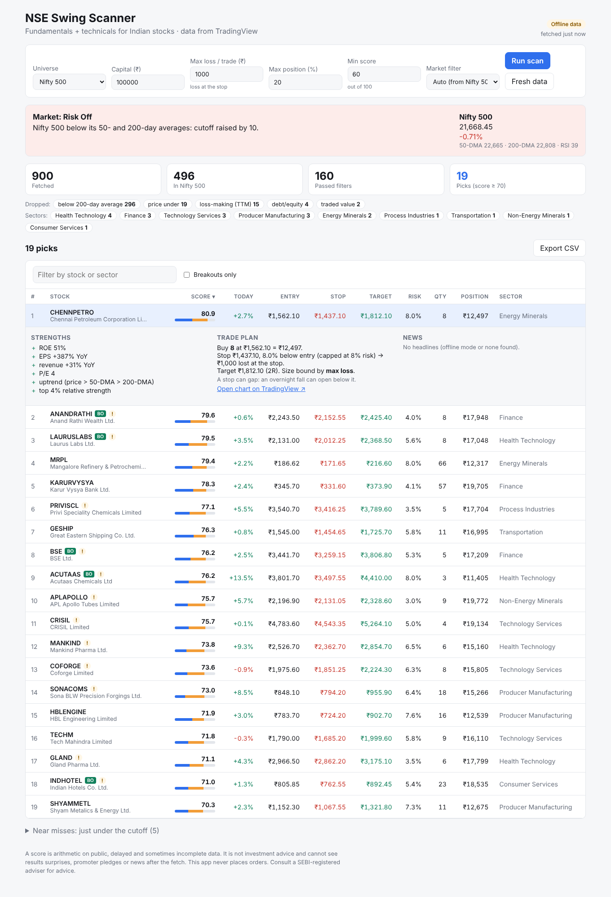

# NSE Swing Scanner (web app)

A React page and a Python (FastAPI) backend that scan Indian stocks on
**fundamentals + technicals** for swing / positional trades, using data from
TradingView. The scoring rules live in one place, the `nse-swing` skill's
[`score.py`](../.claude/skills/nse-swing/score.py), which the backend imports.



## What it does

1. **Market regime**: is the Nifty 500 above its 50- and 200-day averages? If
   not, the score cutoff rises by 10 (switchable).
2. **Fetch**: the ~900 largest NSE stocks from TradingView's screener, then
   keeps the members of the index you pick (Nifty 50/100/200/500, Midcap 150,
   Smallcap 250).
3. **Filter**: price ≥ ₹50, market cap ≥ ₹1,000 cr, ₹5 cr+ traded a day,
   profitable, debt/equity ≤ 1.5 (banks and NBFCs exempt), above the 200-DMA.
4. **Score out of 100**: 50 fundamental (ROE/ROIC, EPS and revenue growth,
   margins, free cash flow, PEG or P/E) + 50 technical (trend, relative
   strength, breakouts, RSI/MACD, volume), with penalties for chasing.
5. **Trade plan per pick**: entry, stop (2× ATR or under the 50-DMA, max 8%),
   2R target, and shares sized to your capital and max loss.

The page shows the funnel, why stocks were dropped, sector concentration, a
sortable/filterable table, per-stock strengths and red flags, TradingView
headlines, a chart link, near misses and CSV export. It never places orders.

## Run it (Windows)

```bat
cd scanner\backend
python -m venv .venv
.venv\Scripts\pip install -r requirements.txt

cd ..\frontend
npm install
npm run build

cd ..\backend
.venv\Scripts\uvicorn app:app --port 8000
```

Open http://localhost:8000. (macOS/Linux: `.venv/bin/...` instead of
`.venv\Scripts\...`.)

**While editing the page**, run the backend as above and `npm run dev` in
`scanner/frontend`, then open http://localhost:5173 (it proxies `/api` to the
backend).

## API

| method | path | what |
| --- | --- | --- |
| GET | `/api/health` | `{ok, mode: live \| offline}` |
| GET | `/api/universes` | the index choices |
| GET | `/api/regime` | Nifty 500 / Nifty 50 vs their 50/200-DMA |
| POST | `/api/scan` | body: `universe, capital, max_loss, max_position_pct, min_score, risk_mode (auto \| on \| off), top, refresh` |
| GET | `/api/news/{SYMBOL}` | latest TradingView headlines for an NSE symbol |

TradingView results are cached for 5 minutes (`NSE_SCANNER_CACHE_SECONDS`);
"Fresh data" on the page bypasses the cache.

## Offline mode

For demos, or where `scanner.tradingview.com` is blocked, point the backend
at saved screener results (JSON with a `data` list, e.g. saved from the
TradingView connector) instead of the network:

```bat
set NSE_SCANNER_OFFLINE=C:\data\page1.json;C:\data\page2.json
set NSE_SCANNER_OFFLINE_REGIME=C:\data\regime.json
```

`regime.json` looks like `{"NSE:CNX500": {"close": 21668, "SMA50": 22664, "SMA200": 22808}}`.
The page shows an "Offline data" badge in this mode.

## Tests

```bat
cd scanner\backend
.venv\Scripts\python -m unittest discover -s tests
python -m unittest discover -s ..\..\.claude\skills\nse-swing\tests
```

The backend tests mock TradingView, so they run without a network.

## Caveats

- TradingView's screener endpoint is **unofficial**: no API key, delayed
  data, and it can change or rate-limit without notice. Fundamentals are
  sometimes missing for a company; the score scales over what is known and
  flags "thin fundamental data".
- A score is a rules check on public data, **not investment advice**. A stop
  can gap: an overnight fall can open below it. Consult a SEBI-registered
  adviser for advice.
